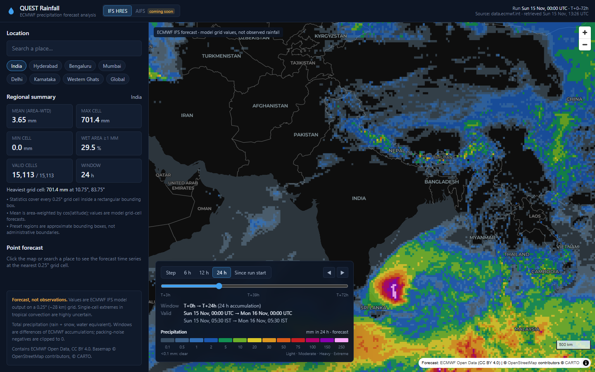

# QUEST Rainfall: ECMWF Precipitation Forecast Application

A full-stack web application for exploring **genuine ECMWF Open Data precipitation forecasts**
(IFS HRES and AIFS Single, 0.25°) on an interactive map, with forecast timelines, regional statistics and
point time series. Built for the QUEST Lab Full Stack AI Pre-doctoral application (IISc Bangalore).

> **Forecast, not observations.** Every value shown is ECMWF model output for a 0.25° (~28 km)
> grid cell. Nothing in the application is mocked, interpolated into existence or "corrected".

- **Repository:** https://github.com/sage-snippets/quest-rainfall
- **Live app:** **https://quest-rainfall.onrender.com** (Render free tier; the first visit after 15 min idle takes about 1–2 min to wake and re-ingest)
- **CI:** GitHub Actions runs backend, frontend and container tests, the container at 512 MB with real ECMWF data



---

## Contents

1. [Features](#features)
2. [Architecture](#architecture)
3. [Technology stack](#technology-stack)
4. [Data source](#data-source)
5. [Scientific processing methodology](#scientific-processing-methodology)
6. [Installation and local development](#installation-and-local-development)
7. [Configuration](#configuration)
8. [API reference](#api-reference)
9. [Testing](#testing)
10. [Deployment](#deployment)
11. [Known limitations](#known-limitations)
12. [Project history and documentation](#project-history-and-documentation)

---

## Features

- **Interactive precipitation map** (MapLibre GL). Server-rendered Web Mercator tiles of real IFS
  `tp` data are drawn beneath the basemap labels, on an absolute colour scale (0.1 mm to over 250 mm).
- **Forecast timeline.** A lead-time slider and step buttons, with accumulation windows of
  *native step* (3 h / 6 h), 6 h, 12 h, 24 h or *since run start*. Windows a run cannot support
  are disabled or explained.
- **Run and validity metadata.** Initialisation time, valid-from and valid-to in UTC and IST,
  source URLs and retrieval time.
- **Region presets:** India (default), Hyderabad, Bengaluru, Mumbai, Delhi, Karnataka, Western Ghats, Global.
- **Location search** (Open-Meteo geocoding, proxied and cached by the backend).
- **Regional summary:** area-weighted mean, min, max, wet-area fraction (≥ 1 mm) and valid cells.
  The heaviest-cell location is shown only when precipitation actually falls.
- **Point forecast.** Click the map or search a place to see a bar chart of precipitation per
  interval at the nearest grid cell.
- **Model selector: IFS HRES and AIFS Single.** AIFS was enabled only after its GRIB metadata was
  inspected and validated against real data (its `tp` is in kg m⁻², not metres). A model disabled
  in configuration (`QR_MODELS`) is shown as *coming soon*, and the API refuses it with `409`.
- **Loading, empty, error and mobile states.** The app shows clear messages when no forecast has
  been ingested, when the geocoder is down, or when tiles fail. Desktop and mobile layouts are both supported.

## Architecture

```
                    ┌──────────────────────── Docker container ─────────────────────────┐
 data.ecmwf.int     │  refresh.py ── at startup, then hourly ──┐                         │
 (ecmwf-opendata,   │                                           ▼                         │
  byte-range tp) ──▶│  acquisition/ecmwf.py  latest complete 00/12z run, retries,         │
                    │                        mirror fallback (aws, azure)                 │
                    │  processing/precip.py  GRIB2 decode + metadata validation,          │
                    │                        m→mm, interval differencing, QC              │
                    │  pipeline.py           atomic publish <run>.partial → <run>/,       │
                    │                        .npy grids + manifest.json, prune            │
                    │  store.py              memory-mapped grids, LRU caches              │
                    │  processing/tiles.py   Web Mercator reprojection → PNG              │
                    │  api/routes.py         FastAPI /api/* (Pydantic v2, JSON errors)    │
                    │  main.py               SPA static serving (same origin), logging    │
                    └──────────────────────────────┬────────────────────────────────────┘
                                                   │ /api/* JSON, PNG tiles, static SPA
                                     React + TypeScript + MapLibre (TanStack Query)
```

- **Precompute at ingest, serve from disk.** User requests never wait on ECMWF. A run is
  immutable once ingested, so responses carry long `Cache-Control` lifetimes.
- **One origin.** FastAPI serves the built SPA, so no CORS setup is needed in production.
- **Bounded memory.** Ingest decodes one step at a time, and the API memory-maps `.npy` grids.
  Measured in the container at 512 MB / 0.1 CPU: 117 MiB after ingest, 207 MiB after the full e2e suite.

Repository layout:

```
backend/
  app/acquisition/ecmwf.py   ECMWF Open Data retrieval, run discovery
  app/processing/precip.py   GRIB2 decoding, validation, interval maths, regional stats
  app/processing/tiles.py    Web Mercator tile renderer, colour scale
  app/pipeline.py            ingest → store (atomic), pruning
  app/refresh.py             background startup ingest + hourly refresh
  app/store.py               read-only store access + caches
  app/api/                   routes, schemas, geocoder
  app/main.py                app factory, middleware, SPA serving
  scripts/                   ingest CLI, GRIB verification, extremes investigation, ecCodes self-test
  tests/                     pytest suite + real ECMWF GRIB2 fixture
frontend/
  src/                       React app (App.tsx, components/, api.ts, window.ts)
  e2e/                       Playwright end-to-end tests
docs/                        investigations, deployment guide, screenshots
Dockerfile, render.yaml, .github/workflows/ci.yml
```

## Technology stack

| Layer | Choice | Why |
|---|---|---|
| Data access | `ecmwf-opendata` 0.3.35 | Official client; downloads only the `tp` messages via HTTP byte ranges |
| GRIB2 decoding | `eccodes` 2.50 (bundled native library); `cfgrib`/`xarray` for test cross-checks only | ECMWF's reference decoder; the native library ships in the wheel, so no OS packages are needed |
| Numerics / imaging | NumPy, Pillow | Vectorised reprojection and palette-mode PNG encoding without GDAL |
| Backend | FastAPI, Pydantic v2, pydantic-settings, uvicorn, httpx | Typed, validated, self-documenting (`/docs`) |
| Frontend | React 19, TypeScript, Vite, Tailwind CSS v4, TanStack Query, MapLibre GL JS 6 | Fast, typed, and a GPU map with raster tile support |
| Basemap | CARTO Dark Matter (keyless, OSM data) | No API key or secret to manage |
| Tests | pytest, Vitest, Playwright | Unit, numerical, API, spatial and browser e2e |
| Delivery | Docker (multi-stage), GitHub Actions, Render free tier | Free, reproducible, container-tested in CI |

## Data source

- **ECMWF Open Data**, <https://data.ecmwf.int/forecasts/>, accessed with the official client
  [`ecmwf-opendata`](https://github.com/ecmwf/ecmwf-opendata). Licence **CC BY 4.0**: © ECMWF.
- **Models** (stream `oper`, type `fc`, 0.25° regular lat/lon, 1440 × 721):

  | | IFS HRES | AIFS Single |
  |---|---|---|
  | Type | Physics-based NWP | Data-driven (machine-learned) |
  | Runs used | 00z, 12z | 00z, 06z, 12z, 18z |
  | Steps | 3-hourly to 144 h, then 6-hourly to 360 h | 6-hourly to 360 h |
  | `tp` encoding | paramId 228, **units `m`** | paramId 228228, class `ai`, **units `kg m**-2`** (= mm) |
  | Packing precision (e.g. 12 h) | 0.244 mm | 0.0625 mm |

- **Variable:** `tp`, total precipitation (rain plus snow, liquid-water equivalent), accumulated
  from the start of the forecast. The units are read from each message (see below).
- **Runs used:** 00z and 12z. Steps are 3-hourly to 144 h, then 6-hourly to 360 h. The app ingests
  0–72 h by default (`QR_INGEST_MAX_STEP`). The 06z and 18z IFS runs belong to a different stream
  (`scda`) that stops at 90 h, so the app skips them.
- **Retention:** ECMWF keeps about 4 days online. The app keeps its own copy of what it ingested.
- **Provenance:** every run's `manifest.json` (exposed via `/api/forecast/latest`) records the
  model, run, steps, source mirror, exact URLs, retrieval and processing times, and per-interval QC diagnostics.

## Scientific processing methodology

All assumptions are **checked against GRIB metadata** and never hard-coded. See
`backend/app/processing/precip.py` and the tests in `backend/tests/`.

1. **Metadata validation.** For every message: `shortName=tp`, `units=m`, `stepType=accum`,
   `startStep=0` (accumulated from the forecast start), `stepUnits=hours`, `gridType=regular_ll`,
   row-major ordering, increments consistent with grid size, a single run per file, and no duplicate
   steps. Any mismatch raises `GribValidationError`.
2. **Geometry from the header.** Latitude and longitude axes are derived from the first-point,
   increment and scan-mode keys. The data are normalised to latitude descending (N→S) and longitude
   ascending in [−180, 180). The real IFS grid starts at 180°, a fact confirmed from the header
   rather than assumed.
3. **Units from metadata:** a table maps the GRIB `units` key to mm: `m` → ×1000 (IFS) and
   `kg m**-2` → ×1 (AIFS; 1 kg m⁻² of water = 1 mm). Any other unit (e.g. a rate in
   `kg m**-2 s**-1`) is rejected. The packing quantum is converted with the same factor. Applying
   IFS's ×1000 to AIFS would inflate rainfall a thousandfold. A deliberately injected version of
   that bug is caught by the AIFS tests. As an independent check, over the same valid day the
   area-weighted global mean was **3.11 mm (AIFS) vs 3.17 mm (IFS)**, with a spatial correlation
   of 0.83.
4. **Accumulated → interval precipitation:** `P(t₁→t₂) = tp(0→t₂) − tp(0→t₁)`, using
   consecutive published steps.
5. **Negative differences and packing precision.** GRIB simple/CCSDS packing quantises values to
   `2^E · 10^−D` (for example 0.122 mm at 6 h, 0.244 mm at 12 h). A negative difference no larger
   than the coarser field's quantum is numerical noise and is set to 0 (and counted in the manifest).
   **Any larger decrease raises `DataInconsistencyError`**, because accumulated precipitation cannot
   fall. A constant field (`bitsPerValue=0`, i.e. step 0) is exact, so its quantum is 0. This
   case was found and fixed in M2.
6. **Missing values.** Bitmap-masked points become NaN, propagate through differences, are
   excluded from statistics and are transparent on the map.
7. **Longer windows.** A window starting at step 0 uses ECMWF's own accumulation. Other windows
   sum the QC-checked native intervals, so they are never negative.
8. **Regional statistics.** Cells inside a (west, south, east, north) box are selected, with
   antimeridian-crossing boxes supported. The mean is **area-weighted by cos(latitude)**. Min, max
   and wet-area fraction (≥ 1 mm) are also reported. Preset regions are approximate rectangles,
   not administrative boundaries.
9. **Point values** come from the nearest grid cell with no interpolation, and the cell centre
   actually used is returned.
10. **Map tiles.** Each pixel centre is inverse-projected from Web Mercator to latitude/longitude
    and mapped to the nearest 0.25° cell. This is true reprojection, not an equirectangular image
    stretched over the map. Tiles use one **absolute** 13-bin colour scale (served at
    `/api/colorscale` so the legend cannot drift) and are never normalised per tile.

**Investigating extremes.** The 2026-11-15 00z run contains values up to 874 mm in 24 h at one
cell. These were investigated (neighbouring cells, time evolution, and MSLP and 10 m wind from the
same run) and found to be genuine model output. They come from a Bay of Bengal low and an equatorial
"grid-point storm". They are kept unaltered and documented in
[docs/investigation-bay-of-bengal-extremes.md](docs/investigation-bay-of-bengal-extremes.md).

## Installation and local development

**Prerequisites:** Python 3.13, Node 22 or later (developed on Node 24), Git. Docker is optional.

```bash
git clone https://github.com/sage-snippets/quest-rainfall.git
cd quest-rainfall

# Backend
cd backend
python -m venv .venv
.venv/Scripts/activate            # Windows;  Linux/macOS: source .venv/bin/activate
pip install -r requirements-dev.txt
python scripts/ingest.py --steps 0 3 6 9 12 15 18 21 24   # download + process a real IFS run
uvicorn app.main:app --port 8000                          # API at http://localhost:8000/docs

# Frontend (second terminal)
cd frontend
npm ci
npm run dev                        # http://localhost:5173 (proxies /api to :8000)
```

**Production-like run with one origin and no Docker.** Run `npm run build` in `frontend/`, then
start uvicorn with `QR_STATIC_DIR=../frontend/dist QR_REFRESH_ENABLED=true`. The server then
ingests the latest run on its own.

**Docker:**

```bash
docker build -t quest-rainfall .
docker run -p 8000:8000 --memory=512m quest-rainfall   # open http://localhost:8000
# optional persistence: -v quest-data:/data
```

## Configuration

Settings come from environment variables with the prefix `QR_` (see `.env.example`).
**No secrets are required.**

| Variable | Default (Docker image) | Purpose |
|---|---|---|
| `PORT` | `8000` | Listen port (Render injects its own) |
| `QR_DATA_ROOT` | `/data/store` | Forecast store location; mount a volume to persist |
| `QR_STATIC_DIR` | `/app/static` | Built SPA to serve from `/` |
| `QR_REFRESH_ENABLED` | `true` | Ingest at startup, then refresh periodically |
| `QR_REFRESH_INTERVAL_S` | `3600` | Seconds between checks for a newer run |
| `QR_INGEST_MAX_STEP` | `72` | Forecast horizon to ingest (h, up to 360) |
| `QR_KEEP_RUNS` | `2` | Runs kept on disk |
| `QR_ARRAY_CACHE_SIZE` | `48` | Memory-mapped grids kept open |
| `QR_TILE_CACHE_SIZE` | `4096` | Rendered PNG tiles kept in RAM |
| `QR_MAX_GRID_CELLS` | `250000` | Size limit for `/grid` responses |
| `QR_CORS_ORIGINS` | localhost:5173 | Only needed when the SPA is served from a different origin |
| `QR_LOG_LEVEL` | `INFO` | JSON log level |

## API reference

Interactive OpenAPI docs are at **`/docs`**. Every error has the shape
`{"error": {"code", "message", "request_id"}}`. `run` is `YYYYMMDDHH`. A window is set by
`end_step` and an optional `start_step`; the default is the native interval ending at `end_step`.

| Endpoint | Description |
|---|---|
| `GET /api/health` | Status, latest run per model, `data_available`, ingest state (`checking`, `ingesting`, `idle` or `error`, plus `last_error`) |
| `GET /api/models` | Both models, with `status` (`operational` if enabled in `QR_MODELS`, else `pending`) and runs available |
| `GET /api/forecast/latest?model=ifs` | Run metadata: steps, intervals with valid times and QC, source URLs, attribution |
| `GET /api/forecast/{model}/{run}/grid?bbox=w,s,e,n&end_step=&start_step=` | Gridded mm values for a box (lat N→S); `413` if over the cell limit |
| `GET /api/forecast/{model}/{run}/summary?region=…\|bbox=…&end_step=&start_step=&wet_threshold_mm=` | Area-weighted regional statistics; `max_location` is `null` when the box is dry |
| `GET /api/forecast/{model}/{run}/timeline?lat=&lon=` | Interval and cumulative series at the nearest grid cell |
| `GET /api/forecast/{model}/{run}/tile/{z}/{x}/{y}.png?end_step=&start_step=` | Web Mercator PNG tile (z 0–10), `Cache-Control: immutable` |
| `GET /api/colorscale` | Absolute colour bins, the legend's source of truth |
| `GET /api/regions` | Preset region boxes |
| `GET /api/geocode?q=` | Place search (Open-Meteo), cached; `502` if the upstream service is unavailable |

Status codes: `404` (unknown run or route), `409` (model pending), `413` (region too large),
`422` (invalid input), `502` (geocoder upstream unavailable), `500` (sanitised; no internals leaked).

Example:

```bash
curl "http://localhost:8000/api/forecast/ifs/2026111500/summary?region=india&start_step=0&end_step=24"
```

## Testing

| Suite | Command | Count | What it covers |
|---|---|---|---|
| Backend | `cd backend && pytest` | 154, plus 1 live test enabled with `RUN_LIVE=1` | GRIB decoding against a **real ECMWF fixture** (ecCodes vs cfgrib, bit-for-bit); metadata validation; interval maths, units, packing tolerance, NaN propagation; longitude/latitude orientation using synthetic GRIB files; antimeridian boxes; area-weighted stats against analytic values; acquisition retries and mirror fallback; 00/12z run discovery; atomic ingest; refresh failure keeping the last run; all API endpoints and error paths; SPA serving and MIME types |
| Tile geometry | (in the backend suite) | 35 | Forward-Mercator prediction of the exact pixel footprint of synthetic cells (both hemispheres, high latitude, equator), north-up/east-right, antimeridian wrap, seamless 2×2 and dateline stitching, absolute colours |
| Frontend unit | `cd frontend && npm test` | 3 | Accumulation-window logic |
| Browser e2e | `cd frontend && npm run e2e` (set `BASE_URL` to target a server) | 6 | Real tiles are 200 PNG; switching to AIFS loads AIFS tiles, metadata and matching statistics; the timeline changes the tile URL; presets move the viewport and the summary matches the API; search and map click give a point forecast; mobile layout without overflow |
| Container (CI) | `.github/workflows/ci.yml` | n/a | Image build with ecCodes self-test, run at 512 MB, real ingest, smoke checks, e2e against the container |

**Test quality checks.** The processing and tile suites were mutation-tested. Bugs were injected
on purpose (no unit conversion, unweighted mean, `abs()` instead of clamping, N/S or E/W flip,
equirectangular stretch, per-tile normalisation and others), and every one made the suite fail.

**Live verification (2026-11-15).** A real IFS retrieval and decode ran end to end, both natively
and inside the container at Render's free limits (512 MB, 0.1 CPU): the API was up in 35 s, real
data was ready in 77 s, and all 5 e2e tests passed.

## Deployment

The app ships as a single Docker image (multi-stage: Node build → `python:3.13-slim`, non-root, `HEALTHCHECK`).

**Recommended free host: Render (free web service)**, defined in `render.yaml`. It builds the
Dockerfile, has a 512 MB / 0.1 CPU plan with no card required, and sleeps after 15 minutes idle.
Its disk is not persistent, which is fine because the app re-ingests the latest real run at every
start. Hugging Face Docker Spaces, Koyeb, Fly.io, Cloud Run and Oracle Cloud were compared; see
[docs/deployment.md](docs/deployment.md) for the comparison and step-by-step instructions.

Deploy: Render → **New → Blueprint** → select this repo → **Apply**. Then check
`https://<service>.onrender.com/api/health` until `data_available` is `true`.

**Live deployment:** https://quest-rainfall.onrender.com, verified on 2026-11-15. Health showed
real IFS run 2026111500 ingested by the server itself; the smoke checks (MIME types, PNG tiles,
summary, timeline, geocode, AIFS 409) passed, and all 5 Playwright e2e tests passed against the live site.

## Known limitations

- **Models:** IFS HRES and AIFS Single (deterministic). The AIFS ensemble (`aifs-ens`) and IFS
  ensemble are not used. AIFS fields are smoother than IFS: for the same valid day its maximum was
  190 mm against 385 mm for IFS. This is model behaviour, not processing.
- **Forecast, not observations.** No verification against rain gauges or satellite (e.g. GPM
  IMERG). Single-cell tropical extremes are highly uncertain.
- **Resolution:** 0.25° (~28 km). Point values use the nearest cell without interpolation, and
  tiles show the grid cells as blocks on purpose.
- **Regions are rectangles,** not administrative boundaries. "India" includes neighbouring land and sea.
- **Map:** Web Mercator cannot show latitudes beyond ±85.05°, although statistics still include them.
- **Horizon:** 0–72 h by default to suit the 0.1 CPU free tier; configurable to 360 h.
- **Free hosting:** cold start after idle (about 1 min to wake plus 20–80 s ingest at 0.1 CPU),
  no persistent disk, and per-process in-memory caches.
- **External services:** the basemap tiles (CARTO) and place search (Open-Meteo) are third-party.
  If they are down, the forecast data still works, but the map background or search does not.
- **Bundle size:** about 380 kB gzipped JavaScript, mostly MapLibre.

## Project history and documentation

Development followed milestones, each committed separately (`git log`):

| Milestone | Content |
|---|---|
| M0 | Scaffold; ecCodes verified on a real GRIB2 file |
| M1 | ECMWF Open Data acquisition |
| M2 | Validated processing, interval maths, regional statistics, extremes investigation |
| M3 | FastAPI backend |
| M4 | Web Mercator tiles and absolute colour scale |
| M5 | React and MapLibre frontend, e2e tests |
| M7 | Docker, background refresh, same-origin SPA, CI, deployment |

- [docs/investigation-bay-of-bengal-extremes.md](docs/investigation-bay-of-bengal-extremes.md): analysis of the extreme values
- [docs/deployment.md](docs/deployment.md): image, runtime behaviour, free-tier comparison, CI
- [backend/tests/fixtures/README.md](backend/tests/fixtures/README.md): provenance of the real ECMWF test fixture
- `docs/img/`: screenshots and tile mosaics from real runs

Developed with Claude Code (Claude Opus 5.5) in a single session. The unedited session log is
preserved as required by the application.

**Attribution:** contains ECMWF Open Data (CC BY 4.0), processed as described above. Basemap ©
OpenStreetMap contributors, © CARTO.
